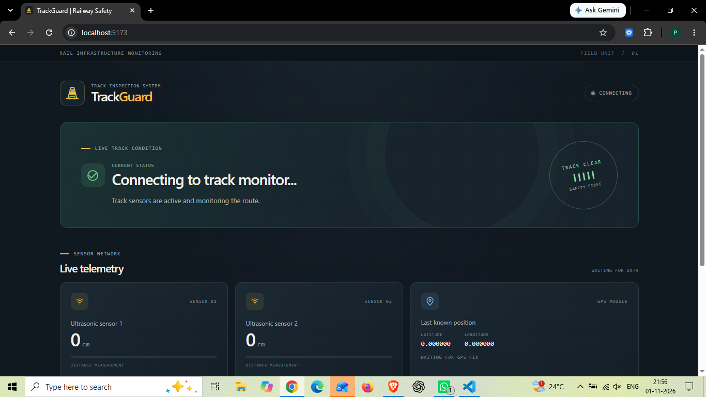
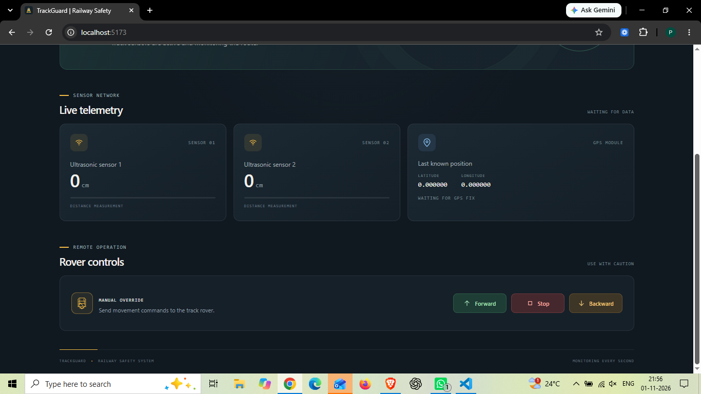
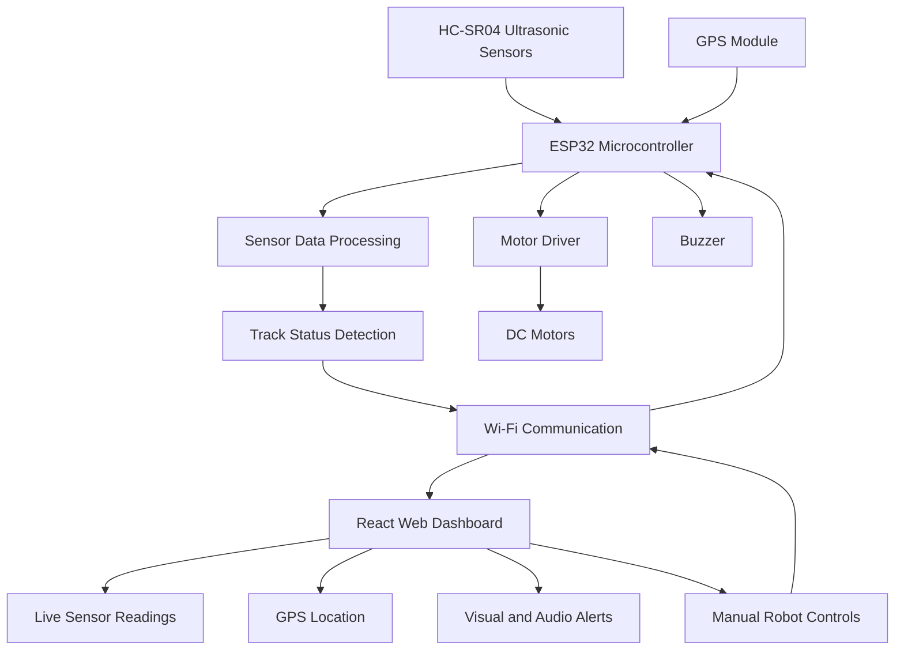

# IoT-Enabled Smart Railway Track Crack Detection and Real-Time Monitoring System

An IoT-based railway safety system designed to detect potential railway track abnormalities and monitor track conditions in real time. The system uses ESP32, dual ultrasonic sensors, and GPS to collect hardware data and display it through a React-based web dashboard.

The project combines embedded systems and web technologies to provide real-time track monitoring, GPS tracking, visual alerts, and manual robot control.

## Table of Contents

- [Project Screenshots](#project-screenshots)
- [Key Features](#key-features)
- [Technologies Used](#technologies-used)
- [System Architecture](#system-architecture)
- [Working Principle](#working-principle)
- [Run Locally](#run-locally)
- [ESP32 Setup](#esp32-setup)
- [Future Enhancements](#future-enhancements)
- [Developer](#developer)

## Project Screenshots

### 1. Connecting to Railway Safety System

<p align="center">
  
</p>

<p align="center">
  
</p>

### 2. Normal Track Condition

<p align="center">
  
</p>

### 3. Track Damage Detected

<p align="center">
  
</p>

## Key Features

- Real-time railway track monitoring.
- Dual ultrasonic sensor readings.
- Potential track abnormality detection.
- GPS-based location tracking.
- React-based web dashboard.
- Live sensor data monitoring.
- Visual and audio alerts.
- Manual robot movement control.
- Wireless communication using ESP32.

## Technologies Used

**Frontend:**

- React.js
- JavaScript
- HTML5
- CSS3
- Vite

**Hardware:**

- ESP32
- HC-SR04 Ultrasonic Sensors (2)
- GPS Module
- L298N Motor Driver
- DC Motors
- Buzzer

**Libraries:**

- NewPing
- TinyGPS++

## System Architecture

The system follows a hardware-software architecture in which ESP32 handles sensor data collection and hardware operations, while React.js provides the frontend dashboard for real-time monitoring and control.

### Architecture Diagram



### Architecture Components

1. **Sensors:** Two HC-SR04 ultrasonic sensors measure track-related distance readings.
2. **ESP32:** Collects sensor readings, processes track status, and handles hardware operations.
3. **GPS Module:** Provides geographical coordinates.
4. **Wi-Fi Communication:** Connects the ESP32 with the React dashboard.
5. **React Dashboard:** Displays sensor readings, track status, GPS coordinates, and alerts.
6. **Motor Control:** Allows manual movement of the robot through the dashboard.

## Working Principle

1. ESP32 collects distance readings from two ultrasonic sensors.
2. The system analyzes sensor readings to identify potential track abnormalities.
3. GPS provides geographical coordinates.
4. ESP32 communicates the collected data to the React dashboard over Wi-Fi.
5. React displays live sensor readings, GPS coordinates, and track status.
6. Visual and audio alerts are generated when abnormal conditions are detected.
7. The robot can also be controlled manually through the dashboard.

## Run Locally

Follow these steps to run the React dashboard on your computer.

**1. Clone the repository**

```sh
git clone https://github.com/is-pankaj05/IoT-Railway-Track-Crack-Detection.git
```

**2. Navigate to the project directory**

```sh
cd IoT-Railway-Track-Crack-Detection
```

**3. Install dependencies**

```sh
npm install
```

**4. Connect to ESP32 Wi-Fi**

Connect your laptop to the `Railway_Safety` Wi-Fi network.

**5. Start the React application**

```sh
npm run dev
```

**6. Open the dashboard**

Open the local URL provided by Vite in your browser, usually:

```text
http://localhost:5173
```

Make sure your ESP32 is powered on and your laptop is connected to its Wi-Fi network for live hardware data.

## ESP32 Setup

1. Upload the ESP32 firmware using Arduino IDE.
2. Connect the ultrasonic sensors, GPS module, motor driver, motors, and buzzer according to the circuit connections.
3. Power on the ESP32.
4. Connect your laptop to the `Railway_Safety` Wi-Fi network.
5. Start the React dashboard using `npm run dev`.

The React frontend runs through the Vite development server, while ESP32 handles hardware communication and sensor data.

## Future Enhancements

- Machine Learning-based track abnormality detection.
- Cloud-based monitoring and data storage.
- Advanced railway safety monitoring.
- Long-range wireless communication.
- Predictive maintenance capabilities.

## Developer

**Pankaj Verma**

B.Tech – Electronics and Communication Engineering

MMMUT, Gorakhpur

GitHub: [is-pankaj05](https://github.com/is-pankaj05)